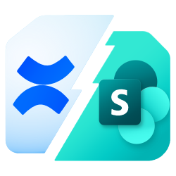
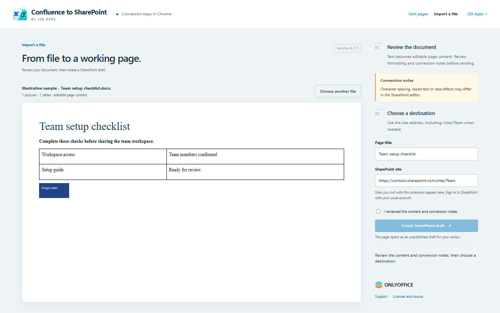
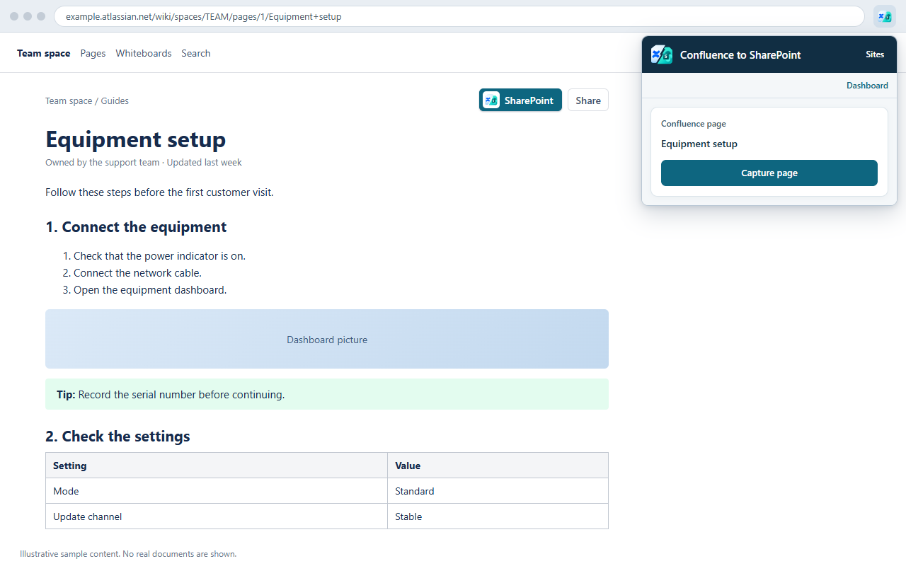
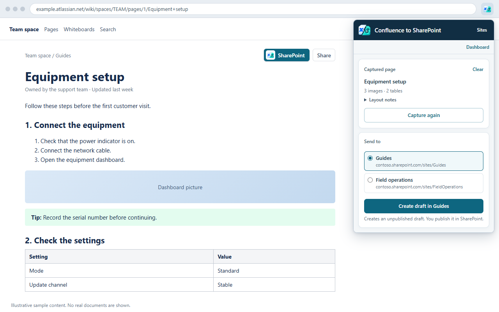
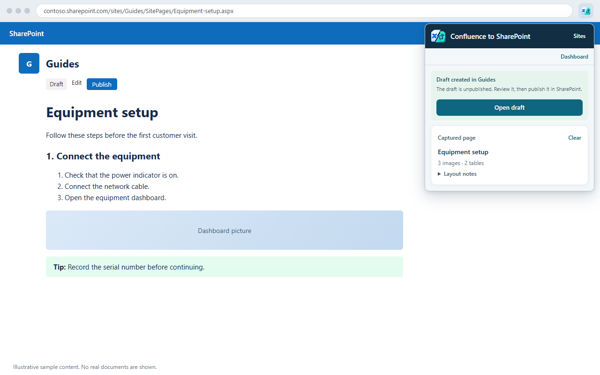
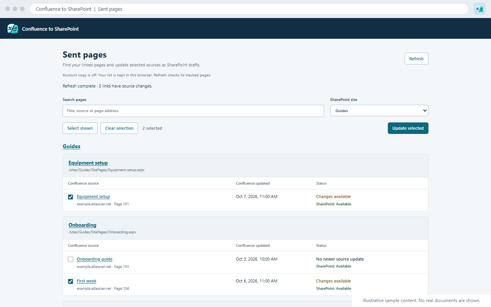

# Confluence to SharePoint



Import Confluence Cloud pages and local documents into editable, **unpublished** SharePoint Online pages, with text, tables, links and pictures. You review and publish in SharePoint.

Capture a Confluence page in Chrome and send it as a new draft, into an existing page, or update a page you sent before. Several Confluence pages can be combined into one SharePoint page. Updates replace the imported part, including any edits made inside that part in SharePoint; the earlier version remains in SharePoint history.

You can also select **Import a file** in the popup or dashboard to turn local documents into editable SharePoint drafts.

- Uses your signed-in SharePoint account. Confluence capture also uses your signed-in Confluence account; local file import does not require Confluence. There is no extra account, app registration, conversion server or API key.
- Never publishes anything. A page you send into keeps showing its readers the published version until you publish the changes.
- Sends your content only to the SharePoint site you choose.

## Install

Install **Confluence to SharePoint** from its [Chrome Web Store page](https://chromewebstore.google.com/detail/ahgjchhmbdpohnbeoccnpnfaeillcedm). You can also find it by searching the Store for its name.

The [published GitHub release is v0.7.2](https://github.com/jb14813/Confluence-to-Sharepoint/releases/tag/v0.7.2). At the 2026-11-11 public-listing check, the Store still offered **0.6.2**; 0.7.2 was submitted separately for review. Do not assume the Store build includes GitHub's newer file-import features until its version changes.

To try the published GitHub build, download the release's **confluence-to-sharepoint-0.7.2.zip**, extract it, open `chrome://extensions`, enable **Developer mode**, select **Load unpacked**, and choose the extracted folder containing `manifest.json`. The source ZIP and `.sppkg` are not Chrome installation packages. Store installations receive Store updates; unpacked installations require manual replacement and **Reload**. An unpacked copy has separate identity/storage from the Store installation. See the [0.7.2 release guide](docs/releases/0.7.2.md) for download links, compatibility, update instructions and verification scope.

To keep it handy, pin it: select the puzzle-piece icon in Chrome's toolbar, then the pin next to **Confluence to SharePoint**.

## Import a file

1. Select **Import a file** in the popup, dashboard, or the extension's shortcut on a SharePoint page.
2. Choose a DOC, DOCX, ODT, RTF, UTF-8 TXT or text-based PDF file up to 50 MiB. Conversion runs locally inside Chrome.
3. Review the reconstructed content and conversion notes, enter a page title and choose the SharePoint site.
4. Select **I reviewed the content and conversion notes**, then **Create SharePoint draft**. The verified, unpublished page opens for review.



Confluence Word exports wrapped in MIME are supported alongside ordinary Word documents. Original bitmap resources are used directly when their display is supported. SVG pictures, nonuniform image views and very narrow graphics can use verified PNG derivatives; the preview explains those adaptations. If an export links to images it did not include, the workspace lists their websites and asks you to select **Load linked images**. Those requests omit cookies and the referring page address. The file itself stays local. Exported application widgets become labeled editable snapshots or source links; an attachment already marked unknown in the source remains explicitly marked unknown.

Text and supported formatting remain editable. Each selected upload is hashed and verified after transfer. The converter retains full decoded PDF raster dimensions using lossless PNG output; compressed file bytes change, and PDF color-space conversion can differ between viewers. Transformed or nonuniform image views can use verified PNG derivatives, and very narrow graphics can gain transparent space to keep them visible in SharePoint. Browser rendering limits and layout adaptations appear in the preview notes. Nontext shapes use the existing engine's rendering. Overlapping PDF layouts reflow into ordinary editable SharePoint content and separate images, with explicit notes when layout or text order changes. No custom document viewer or editor is required. Unsupported structures and image-only PDFs without editable text block sending; OCR is not included. Mixed text/image PDFs need review for words still inside images.

Supported PDF form fields become text, multiline text, checkboxes, dropdowns and radio groups, grouped by source page. Interactive form pages require the companion SharePoint Framework app installed on the destination site. **Licenses and source** in the extension links to the package, installation instructions and response-list permission requirements. The component uses the reader's current SharePoint permissions; it does not grant access. XFA, PDF scripts, calculations and signatures are not supported.

The local file preview is separate from the Confluence capture and does not enter the Confluence sent-page/update history. An interrupted file send keeps its attempt identity and destination so a lost message cannot silently create a second page. Its review/reset controls are in the file workspace; the Sites view's **Forget all** still applies to remembered sites and Confluence links.

Word bullets, supported numbered lists and merged table cells remain native editable structures. The importer uses the Word engine's calculated numbering and merge grid. Verified custom/compound markers become editable literal markers where native numbering cannot represent them; skipped levels use the actual source items without invented parent content. Vertical merges become native row spans. Formatting differences use the closest supported native representation with conversion notes, rather than blocking only because appearance differs.

Headers and footers become labeled editable sections; footnotes and endnotes become linked sections. Known content controls become ordinary editable content, and document fields retain their cached visible results as static text. These do not retain automatic field updates or repeating page headers. Missing/unreadable content, malformed structures, failed verification, unsafe resources and unsupported interactive form behavior remain protected. Direct spreadsheet/presentation import and OCR are not included.

## Copy a page

1. Open the Confluence page in Chrome. Select the teal **SharePoint** button, with the extension's logo, next to Share, or the extension's icon in the toolbar.
2. Select **Capture page**. The popup shows the page's title and what was captured.

   

3. Under **Send to**, choose the SharePoint site to copy into. It lists the sites you pinned and the SharePoint sites open in your tabs.
4. Select **Create draft in** and the site's name. The site opens in a background tab while the draft is created, then the draft comes to the front, with SharePoint's **Edit** and **Publish** (**Submit for approval** on a site whose pages are approved).

   

5. Review and edit the draft, then publish it in SharePoint when you are ready, or submit it for approval where the site's pages are approved.

   

The screenshots show illustrative sample pages, not real documents.

You can close the popup while it works: the capture or the draft carries on, and opening the popup again shows how far it got.

## Send into an existing page

Under **Send to**, the chosen site lists its pages open in your tabs: open the page you want to send into, or keep open the draft you just made. Choose one, and the popup asks **Send to “…”?**:

- **Add to bottom** keeps everything on the page and adds the Confluence page below it, starting with its title as a heading. To combine several Confluence pages into one SharePoint page, create a draft from the first, then add each of the others to it.
- **Overwrite** replaces the page's content, title, byline and date with the Confluence page's. The banner picture and the page's address stay. Use it to update a page after its Confluence page changed. If other Confluence pages were sent into it, the popup says Overwrite removes what they sent too.
- **Cancel** goes back to the site.

This browser remembers what it sent, so a Confluence page is not copied onto a site twice by accident. If the site already has it, **Send to** offers **Update “…”** in place of **Create draft**, and the page that has it offers **Update** in place of **Add to bottom**. You can still send it into another page of the same site, for example a combined page; the popup warns that this makes a second copy. Another browser, or one whose list was cleared, does not know what this one sent, unless you keep the list in your Confluence account (see [Your SharePoint sites](#your-sharepoint-sites)).

Either way the change is an unpublished draft of the page: readers keep the published version until you publish, and the earlier version stays in the page's version history. When the send finishes, the page comes to the front; a tab already showing it is reloaded rather than opening another.

A page open in SharePoint's editor holds it. If it is open in another tab, the send stops and **Show the tab** takes you there: close that tab, then send again. SharePoint takes about a minute to release a page after its editor closes, and the send waits for that. If someone else is editing the page or has it checked out, the popup names them. A page waiting for approval, or scheduled to be published, is not sent to, because sending would withdraw that: send again once it is approved, rejected or published.

## Update a page you sent

The extension remembers which Confluence page you sent to which SharePoint page. Open the popup on a Confluence page you sent before and, while no other page is captured, its card lists those pages under **Sent to**, each with **Update**.

Select **Update**. The extension captures the Confluence page as it is now and puts it into the SharePoint page in place of what it sent there before. As with every send, the change is an unpublished draft and the page comes to the front.

- On a page combined from several Confluence pages, only this page's part is replaced, where it is. The other parts stay, and so do sections and web parts added in SharePoint. Changes made in SharePoint to the part itself are replaced; the earlier version stays in the page's history.
- A page made from this Confluence page, with **Create draft** or **Overwrite**, also gets its title, byline and date again. A part added with **Add to bottom** gets its heading again.
- A page renamed, or moved to a folder of its Site Pages, is found by the permanent ID SharePoint gives it. Update writes the page at its new address, and the list follows it. A different page that now has the old address is never written.
- If the page was deleted or moved to another site, or what the Confluence page sent is no longer on it, nothing changes and the page leaves the list. Unless the Confluence page is also in another page of that site, the popup then offers **Create a new page**, which sends the capture to the same site as a new draft. A page sent with a version before 0.5.0 is known only by its address until its next successful Update, so a rename made before then cannot be followed: such a page still holds the earlier copy.
- **Overwrite** replaces everything on a page, so the other Confluence pages sent to it no longer list it.

The list is kept in this browser, and in your Confluence account if you turn that on (see [Your SharePoint sites](#your-sharepoint-sites)).

## Manage sent pages in the dashboard

Select **Dashboard** in the popup to see the source-to-destination links this browser remembers, grouped by SharePoint site and page. Search, choose a site, or select the links shown on the current page. The list shows 50 links at a time; selections stay checked across filters and pages, and the selection count includes hidden selections. **Confluence updated** is the source page's actual edit date, read on Refresh. **Changes available** identifies a source changed since the revision sent to that destination. SharePoint availability is shown separately under Status.



**Refresh** checks source updates and tracked destinations. It opens one inactive SharePoint library tab per site and reads each destination once for all its linked sources, without checkout, saving or check-in. Successful checks close that tab; a sign-in page stays available for you. Confirmed renames update the local tracking and Send to lists. If **Keep in my Confluence account** is on in Sites, Refresh also reads saved-history buckets on known or open Confluence sites, saves queued history changes and repairs incomplete history records using the existing account-copy behavior. On a new profile, open a previously used Confluence site first. A failed or interrupted scan keeps your local list; a locked or missing destination is reported. A failed source read shows **Unable to check source** and marks a retained date as previously read. Refresh does not discover arbitrary SharePoint pages.

Successful reading-view sends keep the captured Confluence version and edit date locally for comparison, with a separate incomplete marker when content was omitted. An incomplete send shows **Changes available** for a newer source revision and **Update status unknown** otherwise; it cannot establish that the draft contains the full source. Older links, editor or uncertain sends, and history imported from another browser can show changes when the source edit is later than the send, but otherwise remain unknown: a send timestamp cannot establish which revision it captured. Source dates and check results are the readings from your last manual Refresh.

Select **Update selected** and confirm the links and destination count. The batch reuses its own inactive source tab, navigating afresh before every capture, and updates each source's existing imported part using the same Update behavior described above. This avoids copying stale content from a source tab already open before an edit. Rendering-dependent losses pause before writing; review and clear the capture in the popup. Permanent conversion limitations, including omitted live embeds and SVG drawings, produce Updated with notes; their source status stays unknown until a newer source revision is detected. If a source tab is still loading, **Show source tab** in Results and notes brings up the retained tab; wait for it to load before retrying. Edits made inside that imported part in SharePoint are replaced. Updates run one at a time as unpublished drafts, with **Open draft** and any update notes in the results. The dashboard stays in front.

Send or clear an unsent capture in the popup first. The batch reserves the capture workflow while it runs, and the popup says so. **Stop after current** settles the active item, then pauses; **Continue** runs pending links only. **Discard pending** keeps completed results and marks the remainder Not run. **Retry failed** includes only failures known not to have written. A finished batch counts the drafts updated and the links not updated, and opens **Results and notes** when something needs your attention. A send whose outcome is uncertain pauses the batch: review it and clear the protected attempt in the popup before continuing.

Closing or reloading the dashboard tab keeps progress in the same browser session. During Refresh, if a check tab becomes active (including when Chrome selects it after the dashboard tab closes), that site's remaining checks stop and its tab is preserved; Refresh again from the dashboard. Work tabs use the dashboard’s regular browser window while it exists, with another regular window as fallback and incognito excluded. With no regular window, a batch pauses and Refresh reports that a regular window is needed without creating one. The running dashboard warns that closing the work window during a write can interrupt it; that item is kept for review before Continue. Chrome may continue its browser session in the background with no windows open. A worker restart follows the current attempt without blocking dashboard commands, then pauses remaining work for Continue. Authentication and site-access failures also pause the queue. Retry keeps earlier results, skips removed links and retries only proven safe failures. Browser shutdown or an extension reload clears dashboard metadata and never starts updates automatically; an interrupted send still exposes the existing review warning. No automatic monitoring is added.

A failed Refresh keeps one sign-in or access tab per site while that tab remains untouched. After you activate or browse in it, the tab belongs to you: Refresh opens a separate check tab and preserves yours, including filtered Site Pages views.

## Your SharePoint sites

- The SharePoint sites you visit are remembered and listed in the popup's **Sites** view: up to 30, pinned sites first, then the most recently used. Personal OneDrive and the SharePoint admin center are left out.
- **Send to** offers the sites you pin there, always, and any other remembered site while it's open in a tab. Pin the sites you send to often; select **Sites** to pin, unpin or remove a site, or forget them all. A site you choose stays in the list until the popup closes.
- Each site also remembers up to 10 of its pages you opened or sent to. Under **Send to** a site lists the ones open in a tab. The site's home page is never listed. Remove a page in the **Sites** view.
- Remembered sites and pages, and which Confluence pages you sent to them, are kept in this browser. **Forget all** clears them all, with the dashboard's last results, and removing a site or page also forgets what was sent to it.
- **Keep in my Confluence account**, at the foot of the **Sites** view, is off until you turn it on. It saves which Confluence pages you sent where as private settings of your own account on the Confluence sites you send pages from; Atlassian documents that only your account can read them. After Chrome is reset, or on another computer, turn it on and open the popup on a Confluence page: its **Sent to** list and **Update** come back. The sites and pages you only visited stay in the browser.
  - The setting and your pinned sites follow Chrome sync: turning the setting on or off, or pinning or unpinning a site, in one Chrome does the same in every Chrome signed in to your Google account with sync on. Without Chrome sync they stay in that browser.
  - Each computer keeps its own list too, and the account holds what all of them sent. Removing a site or page in the **Sites** view marks it removed in your account on the Confluence sites this computer has sent pages from, so other computers with the setting on drop it when they next read those sites.
  - Turning it off removes the copy from your account on the Confluence sites this computer has sent pages from and leaves a small note there, so a computer without Chrome sync turns it off as well the next time it saves or reads there, and says so; turning it on again removes the note from those sites. Uninstalling the extension does not remove the copy: turn the setting off first.
  - **Forget all** clears this browser's lists, unpins your synced pins and turns the setting off.
- If a site cannot take a draft, for example because its Site Pages library does not keep draft versions, the popup says why under the site's name.

## What gets copied

These come across as editable SharePoint content:

- Headings, paragraphs, lists, numbered steps and check lists
- Tables, with their column widths and cell colors
- Info, note, tip, warning and other panels, as colored callouts
- Code blocks, links, dates, mentions and emoji
- Pictures in their original quality, with their captions, at the size Confluence showed them
- Pictures a page shows from other websites, when those websites allow them to be copied
- Published pages, pages open in the editor, drafts and live docs

Some things change, and the popup lists each one under **Layout notes** so you know what to check before publishing:

- Live content, such as a Jira issue list, becomes a snapshot of its current rows or a link, or is left out.
- A picture inside a list step comes over as a picture under its step, and the list's numbering goes on after it. Text that follows a picture inside the same step goes on after it without the list's indent.
- Pictures inside tables, panels and quotes stay in their cell, panel or quote, as SharePoint's own pictures inside text, with their captions.
- A picture from another website that does not allow copying becomes a link to it.
- SVG pictures become PNG, and pictures wider than SharePoint can show are scaled down to fit.
- The table of contents is left out, because its links would not work in SharePoint.
- Fonts, colors and spacing follow SharePoint's page styles.

## Good to know

- **A tab opened before the page was edited** still shows the older version. Capture says so: reload the tab, then capture again.
- **Live docs save as you type.** If your latest edits had not been saved when you captured, a note says so. Select **Capture again**.
- **Chrome asks for site access.** If your Chrome settings limit the extension to certain sites, the popup shows **Allow site access**, on a page it cannot read or when a send needs a site it may not reach. Allow it for your Confluence and SharePoint sites.
- **SharePoint asks you to sign in.** The popup says so. Select **Show the site’s tab**, sign in as usual, then select **Create draft** again. The extension never asks for your password.
- **A send that stops part-way is not retried automatically**, because a draft or pictures may already exist: the popup says **A draft may already exist**, or **The page may have changed** for a page you sent into. Select **Review Site Pages**, **Review the draft** or **Review the page** to check, then select **Clear** and capture again. A send that stops before anything was written can simply be sent again.
- **After an update** the extension refreshes its button on the Confluence pages you have open. If a button says **Reload this page**, reload it.
- **What you need:** desktop Chrome 127 or later and a SharePoint Online site (on `sharepoint.com`) with a Site Pages library that keeps versioned minor drafts, permission to view/add/edit pages, and permission to upload image assets. Confluence capture also needs a Confluence Cloud page (on `atlassian.net`) you can view; local files do not. Confluence Data Center/Server, SharePoint Server/on-premises, custom domains and major-version-only page libraries are outside the supported contract. Site and organization policies remain authoritative.

## Privacy

Everything happens in your browser. A captured page is kept only for the current Chrome session (**Clear** removes it, and Chrome discards it at its next start), and the content you send goes only to the SharePoint site you choose. The addresses and names of the SharePoint sites and pages you visit are remembered in this browser so you can send pages there, and so is which Confluence page you sent to which SharePoint page, so you can update it later. They are sent nowhere, except that **Keep in my Confluence account** keeps the sent list in your own Confluence account when you turn it on, and that the setting and your pinned sites are kept in Chrome's synced storage, which Chrome syncs through your Google account when Chrome sync is on. There is no server, analytics or tracking. When a page shows a picture from another website, the extension asks that website for the picture so it can copy it. See [PRIVACY.md](PRIVACY.md) for the full privacy policy and [CHANGELOG.md](CHANGELOG.md) for what changed in each version.

This is an independent tool and is not affiliated with Atlassian or Microsoft.

Project: [JZB Apps](https://jzbapps.com/apps/confluence-to-sharepoint/). [Published privacy policy](https://jzbapps.com/apps/confluence-to-sharepoint/privacy/) and [third-party notices](https://jzbapps.com/apps/confluence-to-sharepoint/notices.txt). For support, contact [support@jzbapps.com](mailto:support@jzbapps.com) or use the [GitHub issue tracker](https://github.com/jb14813/Confluence-to-Sharepoint/issues); omit private document content.

## Build from source

```powershell
npm ci
npm --prefix products/file-to-sharepoint ci
npm --prefix products/file-to-sharepoint/sharepoint-form ci
npm run build
```

The build is in `dist/sharepoint-helper/`. To try it, open `chrome://extensions`, turn on **Developer mode**, select **Load unpacked**, and choose that folder.


## Licensing and corresponding source

The combined extension is distributed under GNU AGPL version 3, with the original MIT core notice retained and applicable upstream notices. **Licenses and source** displays the original ONLYOFFICE logo and provides the complete notices, pinned source inventory and corresponding-source download. See [SOURCE-MANIFEST.json](SOURCE-MANIFEST.json) for the release inventory and the packaged build/source instructions.
